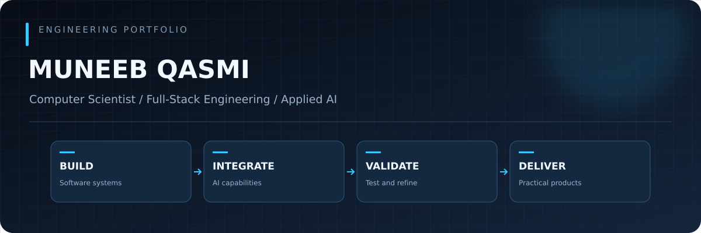
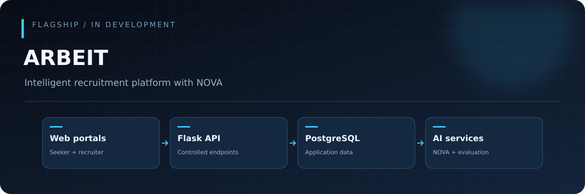
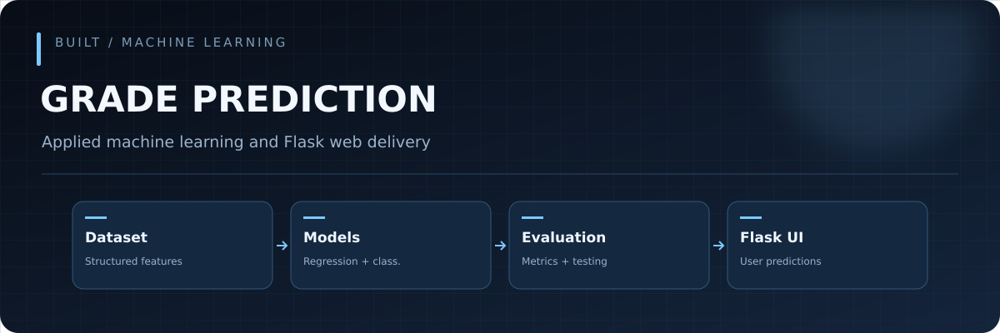
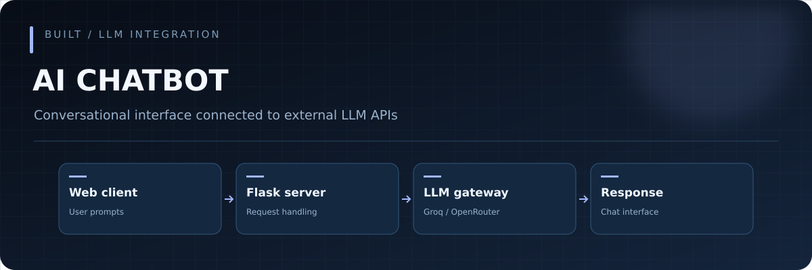
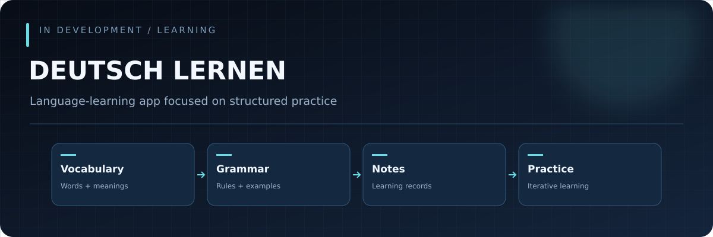
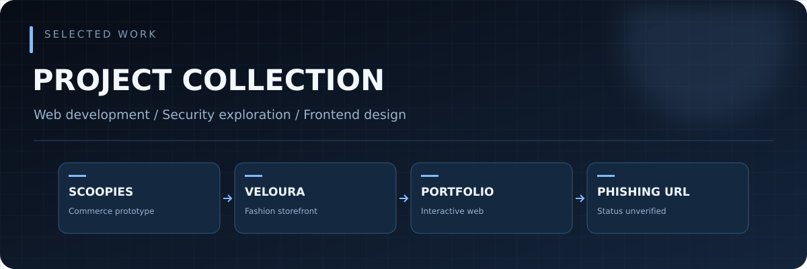

<div align="center">



**Full-stack applications · Applied AI · Backend systems · Interactive web experiences**

[](https://github.com/Muneebqasmi?tab=repositories)
[](https://github.com/Muneebqasmi)

</div>

## About

I build web applications, backend services, and AI-enabled products, focusing on practical functionality, dependable data flows, and interfaces that feel deliberate. My work spans Python and Flask, JavaScript, databases, machine learning, and external language-model integrations.

I enjoy taking a product from requirements to architecture, implementation, testing, and iterative improvement. I am particularly interested in how AI can be integrated into software **without giving up transparency, validation, or user control**.

**Current focus:** ARBEIT, an intelligent recruitment platform; practical AI workflows; and more expressive, accessible web interfaces.

## Technical toolkit

<div align="center">


</div>

| Area | Technologies and practices |
|:--|:--|
| **Backend** | Python, Flask, REST-style endpoints, API integration |
| **Frontend** | HTML, CSS, JavaScript, responsive UI development |
| **Data** | PostgreSQL, SQL, structured data processing |
| **Applied AI** | LLM APIs, prompt workflows, ML experimentation, model evaluation |
| **Web platforms** | PHP, WordPress, e-commerce development |
| **Engineering workflow** | Git, Linux, testing, debugging, iterative delivery |

## Featured projects

### 01 / ARBEIT — Intelligent Recruitment Platform



**Status: In development** · **Stack: Python, Flask, PostgreSQL, JavaScript, PyMuPDF, LLM API**

ARBEIT is a two-sided recruitment platform for job seekers and recruiters. Its planned workflows include CV text extraction and review, job discovery, in-platform applications, candidate-to-vacancy comparisons, and recruiter assistance.

**NOVA**, the agentic voice/text assistant, is designed to interpret job-seeker requests and prepare actions through controlled backend tools. Application submission requires explicit user confirmation. Recruiter-side AI is intended to support requirement extraction, job-description refinement, and evidence-linked candidate review—not autonomous hiring decisions.

**Architecture at a glance:**

```text
Job-seeker UI ──┐
                ├── Flask API / authorization ─── PostgreSQL
Recruiter UI ──┘           │
                           ├── CV text extraction / review
                           └── Controlled AI gateway ── LLM provider
                                    │
                           NOVA (job seeker only)
```

*The illustration and architecture describe the project design, not a claim that every module is complete.*

### 02 / AI Student Grade Prediction



**Status: Built** · **Stack: Python, Flask, machine learning, data processing**

A Flask-based predictive application that uses structured student data to estimate academic outcomes. The work covers preprocessing, model training, evaluation, and exposing predictions through a web interface.

The project explored both GPA regression and grade-category classification, with attention to measuring model performance rather than presenting predictions as guaranteed outcomes.

### 03 / AI Chatbot



**Status: Built** · **Stack: Python, Flask, external LLM APIs**

A conversational web application integrating a Flask backend with external language-model providers such as Groq and OpenRouter. It demonstrates client-server communication, request handling, prompt exchange, and displaying model responses in a usable interface.

### 04 / Deutsch Lernen



**Status: In development** · **Focus: German language learning**

A learning application centered on organizing German vocabulary, grammar, sentences, and personal notes. The design emphasizes structured learning records and accessible study workflows rather than simply copying a quiz-based language-learning interface.

*The diagram represents the intended learning modules, not verified completed functionality.*

## Selected project gallery



| Project | Category | Summary | Status |
|:--|:--|:--|:--|
| **Scoopies** | E-commerce | Ice-cream storefront and commerce prototype | Built prototype |
| **Veloura** | Frontend / commerce | Fashion-oriented storefront and UI work | Built |
| **Personal Portfolio** | Interactive frontend | Personal web presentation and UI experimentation | Built |
| **Phishing URL Detection** | Cybersecurity / ML | URL-classification project requiring confirmation of implementation details | Unverified |

> Project visuals are original **conceptual diagrams**, not screenshots of deployed applications. Individual repository links can be added after their URLs are confirmed.

## GitHub activity

<div align="center">


</div>

These widgets load data from third-party services and may be temporarily unavailable. They show public GitHub contribution activity, not all private or offline development work.

## How I work

**Problem definition → Requirements → Architecture → Implementation → Understanding → Testing → Debugging → Verification → Improvement**

I use AI-assisted development as an engineering tool while retaining responsibility for design choices, understanding important code paths, validating outputs, and testing real behavior.

My interests include dependable AI integrations, secure backend design, meaningful developer tooling, and visual interfaces that balance usability with craft.

---

<div align="center">

**BUILD WITH PURPOSE. ENGINEER WITH CURIOSITY.**

[Explore repositories](https://github.com/Muneebqasmi?tab=repositories)

</div>
