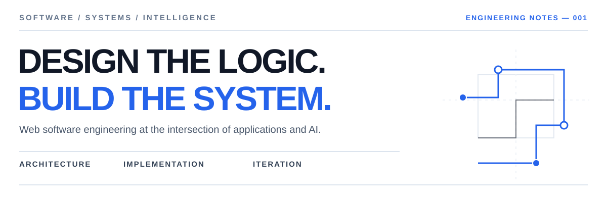

<div align="center">



**SOFTWARE DEVELOPER &nbsp; / &nbsp; WEB ENGINEERING &nbsp; / &nbsp; APPLIED AI**

<br>

[](https://github.com/Muneebqasmi?tab=repositories)
[](https://github.com/Muneebqasmi)

</div>

---

# THE DEVELOPER

### Software Developer | Web Engineering & Applied AI

Software developer working at the intersection of web technologies and artificial intelligence.

I build browser-based applications with an emphasis on system architecture, backend development, database-driven functionality, and responsive interfaces. My current technical focus is incorporating AI into web applications through language model integration, conversational interfaces, and intelligent application workflows.

My development approach emphasizes understanding requirements, designing appropriate solutions, and refining implementations through testing and iteration.

> **Primary focus:** Browser-based software that connects usable interfaces with dependable application logic, structured data, and purposeful AI capabilities.

| WHAT I BUILD | HOW I APPROACH IT |
|:--|:--|
| Browser-based software | Translate workflows and requirements into application features |
| Backend services | Structure endpoints, validation, business rules, and integrations |
| Data-backed applications | Model information and connect interfaces to persistent storage |
| AI-enabled web features | Integrate models through controlled application logic, rather than treating AI output as authoritative |
| Interactive interfaces | Balance clarity, responsiveness, and usability |

<br>

---

# ENGINEERING PRACTICE

### From interface to infrastructure

Web applications are more than their visible pages. I work on the layers that make browser-based software useful: interaction, request handling, business logic, data management, and external service integration.

| DISCIPLINE | AREAS OF WORK |
|:--|:--|
| **Frontend engineering** | HTML, CSS, JavaScript, responsive layouts, interface behavior |
| **Backend development** | Python, Flask, PHP, routing, validation, application logic |
| **Database systems** | SQL, PostgreSQL, MySQL, data models, queries, persistence |
| **Applied AI** | LLM APIs, conversational interfaces, prompt-to-tool workflows, ML experiments |
| **Software design** | Requirements, modularity, component boundaries, information flow |
| **Quality & iteration** | Testing, debugging, handling failures, reviewing implementation choices |

### The engineering loop

```text
REQUIREMENTS  →  DESIGN  →  IMPLEMENT  →  TEST
     ↑                                    |
     └────────── DEBUG & REFINE ──────────┘
```

I use AI development tools as part of this workflow, while keeping architectural decisions, validation, and verification grounded in the actual application.

<br>

---


# 03 / TECHNOLOGY & TOOLING

A collection of languages, frameworks, libraries, platforms, and development tools I've worked with across web engineering, applied AI, and software projects.

<br>

### 01 — PROGRAMMING LANGUAGES

<div align="center">


<br><br>


</div>

<br>

---

### 02 — FRONTEND DEVELOPMENT

<div align="center">


<br><br>


</div>

<br>

---

### 03 — BACKEND ENGINEERING & APIs

<div align="center">


<br><br>


</div>

<br>

---

### 04 — ARTIFICIAL INTELLIGENCE & DATA

<div align="center">


<br><br>


</div>

<br>

---

### 05 — DATABASES & PLATFORMS

<div align="center">


<br><br>


</div>

<br>

---

### 06 — DEVELOPMENT TOOLS & ENVIRONMENT

<div align="center">


<br><br>


</div>

<br>

---

### 07 — ENGINEERING CAPABILITIES

| Area | Technical Focus |
|:--|:--|
| **Web Applications** | Browser-based software, responsive interfaces, client-server architecture |
| **Backend Systems** | Server-side programming, API development, request handling, business logic |
| **Database Engineering** | Relational data modeling, SQL queries, application data persistence |
| **Applied AI** | LLM integration, conversational interfaces, intelligent workflows |
| **Machine Learning** | Data preparation, model training, evaluation, predictive applications |
| **Software Design** | Requirements analysis, modular architecture, implementation planning |
| **Development Practices** | Version control, debugging, testing, iterative improvement |
| **Platforms** | WordPress applications, Linux development environments, Android tooling |

<br>

<sub>Technologies listed represent a mixture of project experience, experimentation, and development tooling rather than equal proficiency in every area.</sub>

<br>

---

<br>

---

# PROJECTS

### Eight projects / newest to oldest

A selection of browser-based applications, AI integrations, predictive software, and frontend work. The descriptions focus on the problem, the technical approach, and the scope of each project—not invented adoption figures or performance claims.

| NO. | PROJECT | ENGINEERING AREA |
|:--:|:--|:--|
| **01** | **ARBEIT** | Recruitment workflows, web architecture, AI assistance |
| **02** | **Deutsch Lernen** | Language learning, structured content, application UX |
| **03** | **AI Chatbot** | Conversational UI, Flask, LLM APIs |
| **04** | **AI Student Grade Prediction** | Machine learning, evaluation, Flask |
| **05** | **Phishing URL Detection** | Security-oriented ML concept; details to verify |
| **06** | **Scoopies** | E-commerce and product presentation |
| **07** | **Veloura** | Fashion storefront and frontend interaction |
| **08** | **Personal Portfolio** | Creative frontend and motion design |

<br>

## 01 — ARBEIT

**Intelligent Job Recruitment Platform**

`Python` `Flask` `PostgreSQL` `JavaScript` `LLM APIs` `PyMuPDF`

ARBEIT brings together job-seeker and recruiter workflows within a single browser-based recruitment platform. The engineering scope includes candidate profiles, CV information, vacancy discovery, application handling, and recruiter-side evaluation tools.

A central design consideration is **NOVA**, a voice-and-text assistant intended to interpret job-seeker requests and work through authorized application functions. The design separates conversational interpretation from backend operations and requires user confirmation for consequential actions such as submitting an application.

**Technical considerations:**

- Separate job-seeker and recruiter workflows, with role-aware backend access.
- PDF text extraction and candidate review before profile information is accepted.
- Job-to-candidate comparisons based on stated requirements and available evidence.
- CV/profile consistency checks that flag discrepancies without claiming to prove employment history.
- Parameterized SQL, audit trails, and clear boundaries around AI-generated suggestions.

<details>
<summary><b>Read the system architecture and design principles</b></summary>

<br>

```text
JOB SEEKER UI                  RECRUITER UI
     |                             |
     +------------+----------------+
                  |
              FLASK API
        Auth / RBAC / Validation
                  |
       +----------+-----------+
       |                      |
   PostgreSQL           Application services
  Persistent data       CV / matching / workflow
                              |
                        Controlled LLM API

NOVA → authorized backend functions → user confirmation
```

AI suggestions support the workflow; they do not independently verify candidate claims or make final recruiter decisions. This is the project's architecture and intended scope, not a claim that every feature has been completed.

</details>

---

## 02 — Deutsch Lernen

**German Language Learning Application**

`Language Learning` `Vocabulary` `Grammar` `Learning Tools` `Web / Android Exploration`

A language-learning application centered on organizing German vocabulary, example sentences, grammar, and personal notes. The concept combines structured learning content with features for reviewing material and managing learning progress.

The emphasis is on a usable learning workspace: clear categorization, editable content, accessible navigation, and a consistent experience across the application's learning tools. The work also involves decisions about persistent user data, authentication, and mobile-friendly delivery.

<details>
<summary><b>Read the product and engineering focus</b></summary>

<br>

- Structured units for words, grammar, and example sentences.
- Personal notes and review-oriented learning organization.
- Responsive interfaces and consideration of offline or installable experiences.
- Persistent application data and account-oriented workflows.

</details>

---

## 03 — AI Chatbot

**Conversational Web Application**

`Python` `Flask` `LLM APIs` `Web UI`

A browser-based chatbot connecting a web interface to a Python/Flask backend and external language-model services. The project explores the application layer around conversational AI: receiving user input, coordinating API requests, handling responses, and presenting conversations through a usable interface.

The important engineering distinction is between **the language model** and **the application around it**. The web application is responsible for the request lifecycle, integration boundaries, user interaction, and error handling; the model supplies generated responses.

---

## 04 — AI Student Grade Prediction

**Predictive Analytics Web Application**

`Python` `Flask` `Scikit-learn` `Pandas` `Machine Learning`

A machine-learning project that uses student-performance data to estimate academic outcomes and expose predictions through a Flask application. The work combines dataset preparation, feature processing, model training, evaluation, and web integration.

| RECORDED EVALUATION | RESULT |
|:--|--:|
| GPA regression — R² | **≈ 0.9283** |
| Grade-class classification — accuracy | **≈ 0.7119** |

<sub>These are recorded evaluation results from the project, not independently audited results or predictions of future accuracy.</sub>

<details>
<summary><b>Read the machine-learning workflow</b></summary>

<br>

`Dataset → Preprocessing → Model training → Evaluation → Flask prediction interface`

The project connects model experimentation with an application that accepts inputs and presents predictions. Evaluation metrics are reported with their task context rather than as general claims of model reliability.

</details>

---

## 05 — Phishing URL Detection

**Security-Oriented Classification**

An explored project area involving the classification of suspicious URLs using features that may distinguish phishing links from legitimate destinations. The precise implementation, dataset, model, and evaluation results have not yet been verified for this profile, so no specific detection accuracy or deployed functionality is claimed.

---

## 06 — Scoopies

**E-Commerce Website**

A storefront project focused on presenting products and supporting an online shopping experience. The work includes web layout, product organization, and e-commerce-oriented interface design, with experience spanning WordPress and website implementation.

---

## 07 — Veloura

**Fashion Storefront**

A fashion-focused web project exploring product presentation, visual hierarchy, responsive design, and interactive frontend behavior. The emphasis is on building a coherent browsing experience through HTML, CSS, and JavaScript.

---

## 08 — Personal Portfolio

**Interactive Frontend Development**

A personal web portfolio used to explore interface composition, animation, and expressive frontend presentation. It represents an opportunity to experiment with technologies such as Three.js and GSAP while keeping navigation and content accessible.

<br>

---

# GITHUB ACTIVITY

### Public repository signals, not a skills score

<div align="center">


<br><br>


</div>

<sub>Statistics are supplied by third-party services and may be temporarily unavailable. Repository language percentages reflect code composition, not proficiency.</sub>

<br>

---

# TECHNICAL DIRECTION

### Where web engineering meets intelligent applications

My current interests are concentrated on the practical side of AI-enabled web software: designing workflows that make model capabilities useful while keeping the rest of the application predictable and maintainable.

| AREA | QUESTIONS I'M EXPLORING |
|:--|:--|
| **AI in web applications** | Where does model assistance meaningfully improve an existing workflow? |
| **Tool-using assistants** | How can natural-language requests map to controlled backend actions? |
| **Data integrity** | How should applications distinguish user input, extracted content, and AI inference? |
| **System boundaries** | What belongs in application code, and what should be delegated to an AI service? |
| **User experience** | How can sophisticated functionality remain understandable and easy to use? |
| **Software reliability** | How should systems behave when an external API is slow, unavailable, or incorrect? |

<br>

---

# WORKING PRINCIPLES

| PRINCIPLE | PRACTICE |
|:--|:--|
| **Start with the problem** | Clarify the workflow and expected behavior before choosing tools. |
| **Keep components accountable** | Give frontend, backend, database, and AI services distinct responsibilities. |
| **Test assumptions** | Verify behavior with real inputs and meaningful edge cases. |
| **Treat AI output carefully** | Validate generated content and keep consequential actions under user control. |
| **Improve through iteration** | Debug, review, and refine after a working implementation exists. |

<br>

---

# CONNECT

Interested in browser-based software, practical AI integration, and the engineering behind useful digital products.

<div align="center">

[](https://github.com/Muneebqasmi)
[](https://github.com/Muneebqasmi?tab=repositories)

<br>

**DESIGN WITH CLARITY. BUILD WITH INTENT.**

</div>
