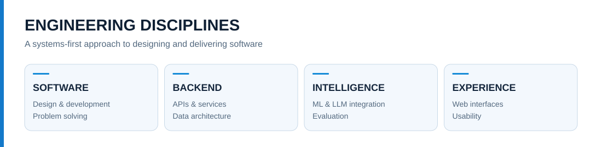
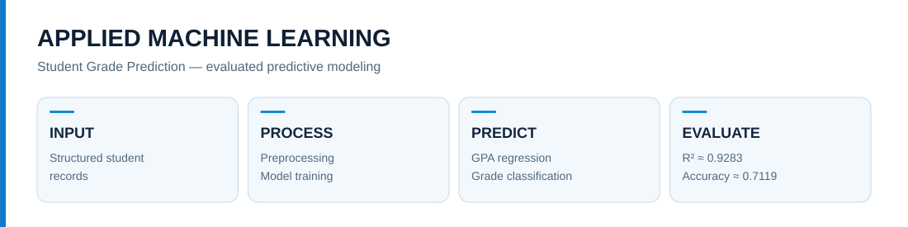
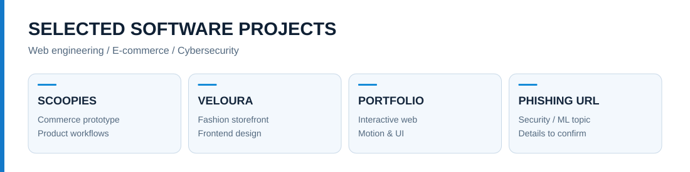
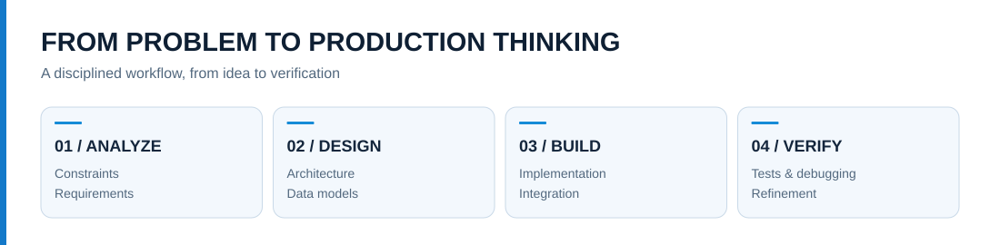

<div align="center">


**Software Developer · Software Design · Backend Engineering · Applied AI**

[](https://github.com/Muneebqasmi?tab=repositories)
[](https://github.com/Muneebqasmi)

</div>

## Software developer. Systems thinker. Problem solver.

I design, develop, and refine software solutions to technical problems. My work is not limited to building websites or connecting APIs: I approach software as an **engineering discipline**, moving from problem analysis and requirements to system architecture, algorithms, implementation, testing, debugging, and continuous improvement.

I work across application logic, backend services, data models, user interfaces, and intelligent software components. I am interested in how these parts fit together: how information moves through a system, where failures occur, what makes an implementation maintainable, and how a technical solution can be made more reliable, secure, and useful.

My experience includes Python-based software, Flask applications, JavaScript interfaces, SQL-backed systems, machine learning experimentation, PHP/WordPress work, and integration with external language-model APIs. I value clear system boundaries, explicit validation, understandable code, and decisions supported by testing rather than assumptions.

> **Engineering objective:** Transform complex requirements into software that is structured, testable, understandable, and capable of evolving.

## Engineering domains



| Discipline | What I work on |
|:--|:--|
| **Software design** | Requirements analysis, modular architecture, data flow, component responsibilities, maintainability |
| **Application engineering** | Software features, business logic, state handling, integration, debugging |
| **Backend systems** | Python, Flask, API endpoints, validation, SQL queries, database interactions |
| **Frontend engineering** | HTML, CSS, JavaScript, responsive interfaces, interaction design |
| **Applied artificial intelligence** | Machine learning, model evaluation, LLM integration, controlled AI workflows |
| **Data engineering fundamentals** | Relational databases, schema thinking, data preparation and structured processing |
| **Software quality** | Functional testing, edge cases, troubleshooting, iterative improvement |

## Technical stack

<div align="center">

**Languages**


**Systems, databases and development tools**


</div>

| Layer | Tools and concepts |
|:--|:--|
| **Programming** | Python, JavaScript, PHP, Java, C |
| **Web application development** | Flask, HTML5, CSS3, responsive design, REST-style APIs |
| **Persistence** | PostgreSQL, MySQL, SQL, structured data |
| **AI and data science** | Scikit-learn, Pandas, predictive modeling, LLM APIs, prompt workflows |
| **Platforms and workflow** | Linux, Git, GitHub, VS Code, WordPress |
| **Additional exploration** | Interactive frontend experiences, UI motion, application architecture |

## Selected engineering work

### 01 — ARBEIT | Intelligent Recruitment Platform

**Python · Flask · PostgreSQL · JavaScript · AI integration · PyMuPDF**

ARBEIT is a software engineering project focused on bringing job discovery, candidate information, applications, and recruiter evaluation into a coherent recruitment system. Its architecture combines distinct job-seeker and recruiter workflows with backend authorization, persistent data, and carefully bounded AI assistance.

**System design and responsibilities**

- **Job-seeker experience:** profile management, CV ingestion and review, vacancy discovery, application preparation, and application tracking.
- **Recruiter experience:** vacancy management, candidate comparison, requirement interpretation, and review support.
- **NOVA assistant:** voice/text interaction designed around controlled backend tools, interpretable actions, and explicit confirmation before submitting applications.
- **Information integrity:** compare candidate-entered claims against CV content, identify inconsistencies, and avoid treating AI inference as independent verification.
- **Engineering boundaries:** role-based authorization, parameterized SQL, auditability, and a usable core application without dependence on AI availability.

**Architecture model**

```text
JOB SEEKER INTERFACE             RECRUITER INTERFACE
         |                               |
         +---------------+---------------+
                         |
                FLASK APPLICATION
              Auth / RBAC / APIs
                         |
             +-----------+-----------+
             |                       |
        POSTGRESQL             SERVICE LAYER
       Persistent data         CV parsing / matching
                                     |
                             CONTROLLED AI GATEWAY
                                     |
                                LLM PROVIDER

NOVA: job-seeker interaction through authorized backend tools
```

This section describes the engineering scope and architecture, without asserting that every capability has already been delivered.

### 02 — AI Student Grade Prediction | Predictive Software



**Python · Flask · Machine Learning · Data Processing**

A predictive application built around student performance data. The system connects a machine learning workflow to a web interface, allowing structured inputs to be processed and predictions to be presented through application logic.

The work covers dataset preparation, feature handling, model training, regression and classification tasks, evaluation, and application integration. Recorded evaluation results from the project were approximately **R² = 0.9283** for GPA regression and **accuracy = 0.7119** for grade-class prediction. These are model evaluation results, not guarantees for new data.

### 03 — AI Chatbot | Conversational Software


**Python · Flask · LLM APIs · Web Interface**

A conversational application connecting a browser-based interface with a Python backend and external model services. It explores the engineering involved in accepting user requests, coordinating server-side API calls, processing model responses, and returning them to the interface.

The project includes experience integrating services such as Groq and OpenRouter and understanding the practical distinction between application-controlled behavior and model-generated output.

### 04 — Deutsch Lernen | Language Learning Software

**Learning workflows · Information architecture · User experience · Application data**

Deutsch Lernen explores a more organized approach to digital language learning. Its central concept is to make vocabulary, grammar, example sentences, and personal notes easy to structure, revisit, and expand, rather than reducing learning to a sequence of quizzes.

The product design considers unit organization, navigation, persistent learning records, and an approachable interface. This section presents the software concept and design scope without claiming that all features are implemented.

## More projects



| Project | Engineering focus | Description |
|:--|:--|:--|
| **Scoopies** | E-commerce / web development | Ice-cream storefront prototype with product-focused commerce workflows. |
| **Veloura** | Frontend / e-commerce | Fashion storefront emphasizing presentation, layout, and web interactions. |
| **Personal Portfolio** | Interactive frontend | Portfolio website exploring visual design and dynamic web experiences. |
| **Phishing URL Detection** | Cybersecurity / ML | Security-oriented URL classification work; implementation details still need confirmation. |

## My engineering workflow



**Problem → Requirements → Design → Implementation → Test → Debug → Verify → Improve**

I use AI-assisted development to accelerate research, prototyping, implementation, and debugging, but keep engineering decisions grounded in requirements and verified behavior. Generated code is a starting point for understanding, testing, and refinement—not a substitute for those steps.

### Principles I apply

- **Design before complexity:** establish responsibilities, boundaries, and data flow before adding unnecessary abstractions.
- **Build for real behavior:** test actual user flows, error paths, and integration points.
- **Keep AI controlled:** separate model suggestions from trusted application actions and user approval.
- **Treat data carefully:** validate inputs, control access, and avoid unsupported claims about information.
- **Improve through evidence:** debug from observed behavior, evaluate trade-offs, and iterate.

## GitHub activity and engineering signals

<div align="center">


</div>

*Third-party charts reflect available public GitHub activity; they do not measure total engineering experience or offline work.*

## What I'm exploring next

| Area | Questions driving my work |
|:--|:--|
| **Software architecture** | How can I design systems that stay understandable as requirements grow? |
| **AI engineering** | How can LLM capabilities be integrated without surrendering application control? |
| **Backend reliability** | How should services handle validation, failures, and data integrity? |
| **Human-centered software** | How can technically capable products also feel intuitive and polished? |
| **Security awareness** | Where are the trust boundaries, and what should be validated or authorized? |

---

<div align="center">

### BUILD SYSTEMS. SOLVE PROBLEMS. KEEP IMPROVING.

[**Explore my repositories**](https://github.com/Muneebqasmi?tab=repositories)

</div>
